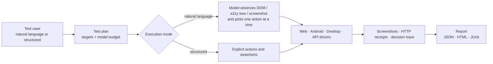

<div align="center">

# AutoRush AI Tester

**A local-first test workbench for Web, Android, Windows desktop and HTTP APIs — with natural-language test cases executed by an AI agent.**

English | [简体中文](README.zh-CN.md)

[](LICENSE)


</div>

---

## What is AutoRush?

AutoRush brings test cases, test plans, model-driven execution and run evidence into one workflow on your own machine.

Describe what to do and what you expect in plain language, or write precise structured steps. AutoRush runs them through the matching driver (browser, phone, desktop window or HTTP), checks the result against your expectation, and produces a report with step-by-step evidence.

- **Write tests the way you think.** A natural-language step such as *"Log in as the demo user and check that the order list is visible"* is carried out by a model that observes the page, picks one action at a time and verifies the expected result.
- **One plan, many platforms.** A single plan can mix Web, Android, desktop and API cases and run them in sequence against the targets you configure.
- **Evidence you can review.** Every step keeps screenshots, HTTP receipts or the model's decision trace. Reports export to JSON, HTML and JUnit XML.
- **Local and in your control.** Runs on `127.0.0.1` with SQLite storage. Target hosts are allow-listed, and model endpoints can be local (llama.cpp, Ollama, LM Studio…) or any compatible remote service.

## Supported platforms

| Platform | Driver | Highlights |
| --- | --- | --- |
| **Web** | Playwright · Chromium | Headed or headless, locating, clicking, typing, selecting, waiting, screenshots |
| **Android** | AutoRush Portal app | QR-code pairing, accessibility-tree actions over WSS, live screen via ADB H.264 |
| **Windows desktop** | PyAutoGUI | Targets a chosen window, checks focus, clicks, keys, scrolls, pixel assertions |
| **HTTP API** | Built-in client | Collections, environments, auth, assertions, variable extraction, Postman / cURL import |

## How it works



1. **Write** a case in the console and save it as a draft.
2. **Approve** it. Approved versions are frozen, and later edits become a new draft version.
3. **Plan.** Pick approved cases, set the targets (URL, device, window, API environment) and, for natural-language cases, a verified model and its budget.
4. **Run** the plan once its pre-flight checks pass.
5. **Review** the report: pass / fail / error / blocked / skipped per case, with evidence for every step.

Natural-language runs are bounded by timeouts, round limits, cancellation and no-progress detection, and every model action is validated by the driver before it runs.

## Feature tour

- **Console**: a React web console, also available as an Electron desktop app, with light and dark themes.
- **Case management**: natural-language and structured modes, filtering by platform, versioning, approval and recoverable deletion.
- **Case import**: upload UTF-8 Markdown or XMind from **Case management → Import cases**, review source locations, edit candidates and create selected drafts in one batch. Download the Markdown template in the dialog or start from [`standard-cases.markdown`](examples/imports/standard-cases.markdown). Missing expectations and ambiguous source content need review; imports never approve or execute cases automatically. Failed batches roll back, and retrying a submission does not create duplicates.
- **Single-case debugging**: run a saved case from its list row, or use the editor's **Debug current content** action without saving. Configure targets and the model in the debug panel, inspect live progress, stop the run and review step evidence. The latest 20 debug records are separate from formal plans and reports; debugging does not save or approve the case.
- **API workbench**: a request editor with tabs, nested folders, environments and `{{variables}}`. It also has a collection runner with CSV/JSON data-driven iterations and a searchable run history. Any request or collection can be saved as an API test case.
- **Android devices**: pair a phone by scanning a QR code, manage authorised devices and watch the screen live.
- **Model settings**: discover local model servers, fetch model lists and verify text and vision capabilities.

## Quick start

**Requirements:** Python 3.11+ (3.12 recommended) · Node.js 20.19+ or 22.12+ · a model service for natural-language runs (no model weights are bundled).

### Windows

```powershell
git clone https://github.com/LingYuWings/AutoRush-AITestingFramework.git
cd AutoRush-AITestingFramework
py -3.12 -m venv .venv-dev

# First run: installs backend, frontend and Chromium, then starts everything.
.\script\windows\start.ps1 -Install `
  -ApiHosts "127.0.0.1,localhost" `
  -WebHosts "127.0.0.1,localhost" `
  -LlmHosts "127.0.0.1,localhost"
```

Windows desktop automation is enabled by default and needs an interactive desktop session. Use `-DesktopAutomation:$false` to disable it. Stop any running backend before changing the desktop setting, which is read at startup. You can drop `-Install` on later runs.

### Linux and macOS

From the cloned repository, create the virtual environment and run the entry point for your OS. Bash and curl are required.

```bash
python3 -m venv .venv-dev
export AUTORUSH_ALLOWED_API_HOSTS=127.0.0.1,localhost
export AUTORUSH_ALLOWED_WEB_HOSTS=127.0.0.1,localhost
export AUTORUSH_ALLOWED_LLM_HOSTS=127.0.0.1,localhost
bash script/linux/start.sh --install  # Linux
# bash script/macos/start.sh --install  # macOS
```

On later runs, omit `--install` and open the console URL shown in the terminal. On Linux, if Chromium reports missing system libraries, install them with `.venv-dev/bin/python -m playwright install-deps chromium`. Native desktop automation is available on Windows.

### Local service addresses

| Service | Address |
| --- | --- |
| Console | <http://127.0.0.1:5173/> |
| API docs | <http://127.0.0.1:8000/docs> |
| Health check | <http://127.0.0.1:8000/health> |

The Windows host options and Linux/macOS environment variables above list the hosts AutoRush is allowed to reach. Add your own test environments there, separated by commas.

### Try it with the demo API

A small in-memory demo service is included for experimenting with the API workbench and API test plans:

```powershell
python examples/local_api_service.py --port 8765
```

Sample case definitions for every platform are in [`examples/`](examples/).

### Android Portal

The Android Portal app and a demo app live in [`android/portal/`](android/portal/). Build them with:

```powershell
.\scripts\setup-android.ps1 -AcceptSdkLicense   # read and accept the Android SDK licence first
.\scripts\build-android.ps1
```

Built APKs and their SHA-256 checksums are saved in the local `release/` directory: `autorush-portal-debug.apk` (Portal) and `autorush-fixture-debug.apk` (demo app). This directory is ignored by Git; these are debug builds, not production releases.

Then open **Android Devices** in the console, generate a pairing QR code and scan it with the Portal app.

## Project layout

```text
backend/          FastAPI service, case contracts, runners, model integration and platform drivers
frontend/         React console and Electron shell
android/portal/   Android Portal and demo app
script/           Windows, Linux and macOS launchers
scripts/          Android build, APK verification and local model tools
examples/         Sample cases and a local demo API service
```

Databases, reports, screenshots, logs, models and credentials are generated locally and kept out of version control.

## Acknowledgements

The Android connection and screen-mirroring design draws on ideas from [Smart-AI-Bot](https://github.com/rejigtian/Smart-AI-Bot). AutoRush is built on open-source projects including Playwright, PyAutoGUI, FastAPI and React.

## License

Released under the [MIT License](LICENSE). Third-party components are subject to their own licences.
