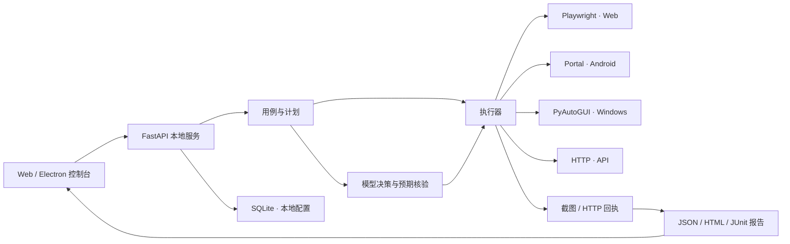
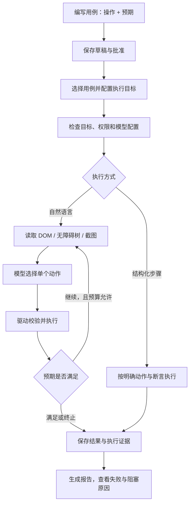

# AutoRush AI Testing Framework

面向 Web、Android、Windows 桌面与 HTTP API 的本地自动化测试工作台。

AutoRush 将用例管理、执行计划、模型决策和执行证据放在同一个流程中：用自然语言描述操作与预期，或使用结构化步骤；由对应驱动执行，再检查结果并生成报告。

## 架构



控制台负责配置与查看结果；Python 后端负责执行、目标校验和持久化。Android 端通过 Portal 建立设备连接；桌面自动化在独立工作进程中操作指定窗口。模型服务可单独部署，也可接入兼容的远程端点。

## 执行流程



## 当前能力

| 范围 | 能力 |
| --- | --- |
| Web | Playwright Chromium；有头/无头运行；元素定位、点击、输入、选择、等待和截图 |
| Android | Portal 扫码配对；无障碍树与动作执行；WSS 连接；配对设备的 ADB H.264 投屏与 WSS 截图预览 |
| Windows 桌面 | PyAutoGUI；指定窗口与前台状态检查；点击、ASCII 输入、快捷键、滚动及像素断言 |
| HTTP API | 独立工作台、请求集合、环境变量、四种鉴权、六种正文格式、响应断言与提取、历史恢复及用例内 API 节点 |
| 用例管理 | 自然语言与结构化模式；按执行端分类；草稿编辑、批准、版本保留与可恢复删除 |
| 测试计划 | 多平台用例串行混合执行；配置浏览器、设备、窗口、API 地址和模型预算 |
| 运行报告 | 通过、失败、错误、阻塞、跳过状态；报告搜索；步骤证据；JSON、HTML、JUnit 导出 |
| 模型接入 | 模型配置、连接验证、本地服务发现；自然语言执行中的逐步观察与核验 |

自然语言执行需要可用的模型与明确的预期。每次决策只执行一个动作，并受超时、轮数、取消和无进展停止机制约束。执行结果仍应结合报告与真实证据审阅。

### API 工作台

按下方说明安装和启动，在“API 测试”中组织集合与环境，编辑请求并发送；支持 Basic、Bearer、Header/Query API Key，以及 JSON、Raw、URL Encoded、Multipart、Binary 请求正文。

API 测试分为“请求工作台、集合 Runner、环境管理、执行历史”四页。工作台支持多级文件夹、请求移动与排序、多个请求标签；草稿和响应分别保留，关闭标签或离开模块时提示处理未保存内容。请求库在工作区内共享，不随每个新标签重复下载。

集合 Runner 可选择集合或文件夹、勾选并调整本次请求顺序，配置 CSV/JSON 数据、迭代次数、请求前延迟、总超时和失败策略。后台运行可取消；切换页面不会停止任务。请求和环境在启动时冻结，重启服务后未完成任务标为中断，绝不自动重发。历史支持搜索、状态筛选、分页证据，以及 JSON、HTML、JUnit 下载；“按原快照重新运行”和“按最新配置运行”分别处理历史复验与最新回归。

用 `{{变量名}}` 引用环境或上一步提取结果，添加状态码、正文、JSON 字段、响应头和耗时断言。集合串行运行时可传递变量与 Cookie；这些运行值不覆盖已保存环境。可导入导出 Postman v2.1 集合、环境和常见 cURL 请求，导入内容作为数据读取，不执行 JavaScript 或 shell。

请求可保存为 API 用例，也可在 Web、Android、Desktop 用例中插入 API 节点。批准后的节点使用请求快照，计划就绪时冻结所选 API 环境；后续编辑不会改变历史执行内容。API 节点按明确请求执行，不消耗模型决策轮数。提取的敏感值不能展开到模型指令中。

API 工作台限可信的本机操作员使用，目标受 `-ApiHosts` 限制。上传、响应及迭代数据文件上限为 1 MiB；单请求历史最多 200 条、集合运行最多 100 条。历史与报告正文按 64 KiB 截断，每次集合运行保留的响应总量上限 10 MiB，超额仍保留结果并注明正文省略。文件夹最多 8 层，工作台最多打开 20 个请求标签；Runner 一次最多选 100 个请求，迭代与数据行最多 1000，实际请求总数不得超过 1000，每个本地服务同时运行一个集合任务。请求配置使用本地密钥加密保存，备份时需同时保留数据库及同目录的 `api-testing-vault.key`。导出默认隐藏识别到的凭据。当前不包含 OAuth 自动授权、任意 Postman JavaScript、WebSocket 或 gRPC 调试；文件请求请优先使用集合格式交换，并重新选择导入文件。

## 快速开始

以下命令以 **Windows PowerShell** 为例。桌面自动化需要 Windows 的交互式桌面会话。

### 环境

- Python 3.11 或更高版本，建议使用 3.12。
- Node.js 20.19+ 或 22.12+。
- Web 自动化需要安装 Playwright Chromium。
- Android 功能需要 Portal APK；ADB 投屏另需开启手机 USB 调试。
- 自然语言执行需要配置模型服务；仓库不包含模型权重。

### 安装与启动

```powershell
git clone https://github.com/LingYuWings/AutoRush-AITestingFramework.git
cd AutoRush-AITestingFramework
py -3.12 -m venv .venv-dev

# 首次启动：安装后端、前端及 Chromium，并启用 Windows 桌面能力。
.\scripts\start.ps1 -Install -DesktopAutomation `
  -ApiHosts "127.0.0.1,localhost" `
  -WebHosts "127.0.0.1,localhost" `
  -LlmHosts "127.0.0.1,localhost"
```

不需要桌面自动化时，去掉 `-DesktopAutomation`。首次安装完成后，后续启动可去掉 `-Install`；命令行参数只对新启动的后端生效。

默认地址：

- 管理台：<http://127.0.0.1:5173/>
- 后端接口文档：<http://127.0.0.1:8000/docs>
- 健康检查：<http://127.0.0.1:8000/health>

启动脚本会保持运行，按 `Ctrl+C` 停止由该脚本启动的进程。需要只检查环境时，可使用 `-CheckOnly`；不自动打开浏览器可使用 `-NoBrowser`。

### 配置测试目标

`-ApiHosts`、`-WebHosts` 和 `-LlmHosts` 分别配置允许访问的 API、网页和模型主机。测试其他环境时，将上例中的本地主机替换或扩展为自己的测试主机，多个名称以逗号分隔。

1. 在“用例管理”选择执行端，填写操作步骤和可检查的预期。
2. 保存并批准用例。
3. 在“测试计划”中选择已批准用例，填写所需目标。
4. 自然语言用例需选择已通过验证的模型，并配置执行预算。
5. 将计划置为就绪后运行，在“运行报告”查看步骤与证据。

桌面执行默认关闭，启用后仍需选择目标窗口。首版桌面驱动针对 Windows 主屏，直接文本输入支持 ASCII；不要依赖后台窗口接收键鼠操作。

### 模型服务

先启动自己的模型服务，再在“系统设置”中添加配置、获取模型列表并测试连接。自然语言执行支持 OpenAI Chat / Responses 兼容协议；桌面视觉执行还需要通过图片能力验证。

本地模型服务和 AutoRush 的生命周期相互独立。使用远程模型时，供应商密钥通过后端环境变量引用，例如配置 `env:MODEL_API_KEY`，不要将真实密钥提交到仓库。

## Android Portal

Android 工程位于 `android/portal/`，包含 Portal 和专用演示应用。

首次准备构建工具前，请先阅读并接受 Android SDK 许可，再执行：

```powershell
.\scripts\setup-android.ps1 -AcceptSdkLicense
.\scripts\build-android.ps1
```

构建结果保存在本机 `artifacts/apk/`。仓库不包含 SDK、JDK、签名密钥或 APK。

安装 Portal 后：

1. 让手机与电脑位于可互通的网络，在管理台进入“Android 设备”。
2. 启动本地设备服务，生成配对二维码。
3. 在手机 Portal 扫码，核对连接地址并确认连接。
4. 按需要启用无障碍服务与截图许可，再选择测试应用范围。

手机支持允许列表，也可在本机明确开启“允许操作任意应用”。截图许可单独控制。

流畅投屏采用 **ADB H.264 → WebCodecs canvas**，需要 ADB 连接与配对身份匹配，不需要 Android 系统录屏授权；ADB 不可用时，可使用需要手机截图许可的 WSS 预览。WSS 连接并不等于手机已授予无障碍或截图权限。

## 构建控制台

```powershell
npm --prefix frontend run build

# 可选：生成 Electron Windows 控制台安装包。
npm --prefix frontend run electron:dist
```

Electron 是控制台外壳，Python 后端、模型服务和 Android 工具仍需单独准备。默认开发方式为本地 Web 控制台。

## 目录

```text
backend/          FastAPI、用例契约、执行器、模型接入与各平台驱动
frontend/         React 管理台与 Electron 外壳
android/portal/   Android Portal 与演示应用
scripts/          环境启动、Android 构建与 APK 校验工具
examples/         公开请求与用例格式样例
README.md         公开使用说明
```

运行时生成的数据库、报告、截图、日志、模型、工具下载和本地凭据不纳入版本管理。自动化测试目录、验收脚本与内部设计文档也暂不包含在公开仓库中。

## 参考

Android 连接和投屏设计参考了 [Smart-AI-Bot](https://github.com/rejigtian/Smart-AI-Bot) 的工程思路。AutoRush 使用自身的用例、计划、设备协议与报告实现，并依赖 Playwright、PyAutoGUI、FastAPI 等开源组件。
