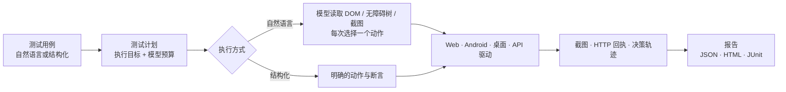

<div align="center">

# AutoRush AI Tester

**面向 Web、Android、Windows 桌面与 HTTP API 的本地测试工作台——用自然语言编写用例，由 AI 代理执行。**

[English](README.md) | 简体中文

[](LICENSE)


</div>

---

## AutoRush 是什么？

AutoRush 在本机上把用例、测试计划、模型驱动执行与运行证据串成一条完整流程。

你可以用自然语言描述“做什么、期望什么”，也可以编写精确的结构化步骤。AutoRush 交给对应的驱动（浏览器、手机、桌面窗口或 HTTP）执行，按预期核验结果，并生成带逐步证据的报告。

- **按你的思路写测试。** 例如“使用演示账号登录，确认订单列表可见”这样的自然语言步骤，会由模型观察页面、每次选择一个动作执行，并核验预期结果。
- **一个计划，覆盖多端。** 同一个计划可以混合 Web、Android、桌面和 API 用例，按你配置的目标依次执行。
- **证据可审阅。** 每一步都保留截图、HTTP 回执或模型决策轨迹；报告可导出为 JSON、HTML 与 JUnit XML。
- **本地运行，自主可控。** 服务运行在 `127.0.0.1`，数据存放于 SQLite；访问的目标主机需列入允许列表；模型可用本地服务（llama.cpp、Ollama、LM Studio 等），也可接入兼容的远程端点。

## 支持的平台

| 平台 | 驱动 | 主要能力 |
| --- | --- | --- |
| **Web** | Playwright · Chromium | 有头/无头运行，元素定位、点击、输入、选择、等待、截图 |
| **Android** | AutoRush Portal 应用 | 扫码配对，基于 WSS 的无障碍树操作，ADB H.264 实时投屏 |
| **Windows 桌面** | PyAutoGUI | 指定目标窗口并检查前台状态，点击、按键、滚动、像素断言 |
| **HTTP API** | 内置客户端 | 集合、环境、鉴权、断言、变量提取，支持导入 Postman / cURL |

## 工作方式



1. **编写**：在控制台中编写用例，保存为草稿。
2. **批准**：已批准的版本会被冻结，之后的修改另存为新的草稿版本。
3. **计划**：选择已批准用例，配置执行目标（网址、设备、窗口、API 环境）；自然语言用例还需选择已验证的模型及执行预算。
4. **运行**：预检查通过后运行计划。
5. **审阅**：在报告中查看每个用例的通过、失败、错误、阻塞或跳过状态，以及每一步的证据。

自然语言执行受超时、轮数上限、取消和无进展检测约束；模型给出的每个动作都要先经驱动校验才会执行。

## 功能一览

- **控制台**：React 网页控制台，也可打包为 Electron 桌面应用，支持浅色和深色主题。
- **用例管理**：支持自然语言和结构化两种模式，可按执行端筛选，支持版本管理、批准与可恢复删除。
- **单用例调试**：从用例列表点击运行按钮，或在编辑器点击“调试当前内容”，无需先保存或批准。在调试面板配置目标与模型、查看实时进度、停止运行并检查逐步证据。“调试记录”保留最近 20 条独立记录，不混入正式计划和报告，调试不会保存或批准原用例。
- **API 工作台**：多标签请求编辑器，支持多级文件夹、环境和 `{{变量}}`；集合 Runner 支持 CSV/JSON 数据驱动迭代，执行历史可搜索。请求或整个集合都可以一键保存为 API 测试用例。
- **Android 设备**：扫码配对手机，管理已授权设备，实时查看画面。
- **模型设置**：发现本地模型服务，获取模型列表，验证文本与视觉能力。

## 快速开始

> 以下脚本以 **Windows PowerShell** 为例。桌面自动化需要交互式 Windows 桌面会话。

**环境要求：** Python 3.11+（建议 3.12）· Node.js 20.19+ 或 22.12+ · 自然语言执行需要模型服务（仓库不含模型权重）。

```powershell
git clone https://github.com/LingYuWings/AutoRush-AITestingFramework.git
cd AutoRush-AITestingFramework
py -3.12 -m venv .venv-dev

# 首次启动：安装后端、前端及 Chromium，并启动全部服务。
.\scripts\start.ps1 -Install `
  -ApiHosts "127.0.0.1,localhost" `
  -WebHosts "127.0.0.1,localhost" `
  -LlmHosts "127.0.0.1,localhost"
```

如需 Windows 桌面测试，加上 `-DesktopAutomation`。完成首次安装后，以后启动可以不加 `-Install`。

| 服务 | 地址 |
| --- | --- |
| 控制台 | <http://127.0.0.1:5173/> |
| 接口文档 | <http://127.0.0.1:8000/docs> |
| 健康检查 | <http://127.0.0.1:8000/health> |

`-ApiHosts`、`-WebHosts`、`-LlmHosts` 分别列出 AutoRush 允许访问的 API、网页和模型主机。测试自己的环境时，把主机名加进去，多个主机名用逗号分隔。

### 用演示 API 体验

仓库附带一个基于内存的演示服务，可用来试用 API 工作台和 API 测试计划：

```powershell
python examples/local_api_service.py --port 8765
```

各平台的用例样例见 [`examples/`](examples/)。

### Android Portal

Android Portal 及演示应用位于 [`android/portal/`](android/portal/)。构建方式：

```powershell
.\scripts\setup-android.ps1 -AcceptSdkLicense   # 请先阅读并接受 Android SDK 许可
.\scripts\build-android.ps1
```

APK 及对应的 SHA-256 校验文件输出到本地 `release/` 目录：`autorush-portal-debug.apk`（Portal）与 `autorush-fixture-debug.apk`（演示应用）。该目录不纳入 Git；这些安装包是调试构建，并非生产发布版本。

然后在控制台进入 **Android 设备**，生成配对二维码，用 Portal 应用扫码连接。

## 目录结构

```text
backend/          FastAPI 服务、用例契约、执行器、模型接入与各平台驱动
frontend/         React 控制台与 Electron 外壳
android/portal/   Android Portal 与演示应用
scripts/          启动、Android 构建与 APK 校验工具
examples/         用例样例与本地演示 API 服务
```

数据库、报告、截图、日志、模型与凭据均在本地生成，不纳入版本管理。

## 致谢

Android 连接与投屏设计参考了 [Smart-AI-Bot](https://github.com/rejigtian/Smart-AI-Bot) 的思路。AutoRush 基于 Playwright、PyAutoGUI、FastAPI、React 等开源项目构建。

## 许可证

本项目采用 [MIT License](LICENSE) 发布。第三方组件遵循各自的许可证。
