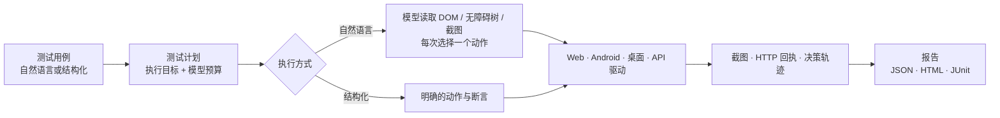

<div align="center">

# AutoRush AI Tester

**面向 Web、Android、Windows 桌面与 HTTP API 的本地测试工作台——用自然语言编写用例，由 AI 代理执行。**

[English](README.md) | 简体中文

[](LICENSE)


</div>

---

## AutoRush 是什么？

AutoRush 在本机上把用例、测试计划、模型驱动执行与运行证据串成一条完整流程。

你可以用自然语言描述“做什么、期望什么”，也可以编写精确的结构化步骤。AutoRush 交给对应的驱动（浏览器、手机、桌面窗口或 HTTP）执行，按预期核验结果，并生成带逐步证据的报告。

- **按你的思路写测试。** 例如“使用演示账号登录，确认订单列表可见”这样的自然语言步骤，会由模型观察页面、每次选择一个动作执行，并核验预期结果。
- **一个计划，覆盖多端。** 同一个计划可以混合 Web、Android、桌面和 API 用例，按你配置的目标依次执行。
- **证据可审阅。** 每一步都保留截图、HTTP 回执或模型决策轨迹；报告可导出为 JSON、HTML 与 JUnit XML。
- **本地运行，自主可控。** 控制台和管理 API 默认使用本机回环地址，数据存放于 SQLite。Android 同 Wi-Fi 配对使用按需启动的独立 WSS 服务。可配置目标访问范围，模型可用本地服务（llama.cpp、Ollama、LM Studio 等），也可接入兼容的远程端点。

## 支持的平台

| 平台 | 驱动 | 主要能力 |
| --- | --- | --- |
| **Web** | Playwright · Chromium | 有头/无头运行，元素定位、点击、输入、选择、等待、截图 |
| **Android** | AutoRush Portal 应用 | USB 或 Wi-Fi 扫码配对、局域网自动回连、无障碍操作、ADB H.264 实时投屏 |
| **Windows 桌面** | PyAutoGUI | 指定目标窗口并检查前台状态，点击、按键、滚动、像素断言 |
| **HTTP API** | 内置客户端 | 集合、环境、鉴权、断言、变量提取，支持导入 Postman / cURL |

## 工作方式



1. **编写**：在控制台中编写用例，保存为草稿。
2. **批准**：已批准的版本会被冻结，之后的修改另存为新的草稿版本。
3. **计划**：选择已批准用例，配置执行目标（网址、设备、窗口、API 环境）；自然语言用例还需选择已验证的模型及执行预算。
4. **运行**：预检查通过后运行计划。
5. **审阅**：在报告中查看每个用例的通过、失败、错误、阻塞或跳过状态，以及每一步的证据。

自然语言执行受超时、轮数上限、取消和无进展检测约束；模型给出的每个动作都要先经驱动校验才会执行。

## 功能一览

- **控制台**：React 网页控制台，也可打包为 Electron 桌面应用，支持浅色和深色主题。
- **用例管理**：支持自然语言和结构化两种模式，可按执行端筛选，支持版本管理、批准与可恢复删除。
- **用例导入**：在“用例管理 → 导入用例”上传 UTF-8 Markdown 或 XMind，查看来源位置、修改预览并批量创建选中的草稿。面板可下载 Markdown 模板，也可参考 [`standard-cases.markdown`](examples/imports/standard-cases.markdown)。缺少预期或原文存在歧义时须核对；不会自动批准或执行。批量失败全部回滚，提交重试不会重复创建。
- **单用例调试**：从用例列表点击运行按钮，或在编辑器点击“调试当前内容”，无需先保存或批准。在调试面板配置目标与模型、查看实时进度、停止运行并检查逐步证据。“调试记录”保留最近 20 条独立记录，不混入正式计划和报告，调试不会保存或批准原用例。
- **API 工作台**：多标签请求编辑器，支持多级文件夹、环境和 `{{变量}}`；集合 Runner 支持 CSV/JSON 数据驱动迭代，执行历史可搜索。请求或整个集合都可以一键保存为 API 测试用例。
- **Android 设备**：扫码配对手机，管理已授权设备，实时查看画面。
- **模型设置**：发现本地模型服务，获取模型列表，验证文本与视觉能力。

## 快速开始

**环境要求：** Python 3.11+（建议 3.12）· Node.js 20.19+ 或 22.12+ · 自然语言执行需要模型服务（仓库不含模型权重）。

### Windows

```powershell
git clone https://github.com/LingYuWings/AutoRush-AITestingFramework.git
cd AutoRush-AITestingFramework
py -3.12 -m venv .venv-dev

# 首次启动：安装后端、前端及 Chromium，并启动全部服务。
.\script\windows\start.ps1 -Install `
  -ApiHosts "127.0.0.1,localhost" `
  -WebHosts "127.0.0.1,localhost" `
  -LlmHosts "127.0.0.1,localhost"
```

Windows 默认启用桌面自动化，需要交互式桌面会话。可用 `-DesktopAutomation:$false` 显式关闭。后端在启动时读取该设置，切换前请先停止正在运行的后端。完成首次安装后，以后启动可以不加 `-Install`。

当已校验的本地 Qwen 运行时与权重安装在 `artifacts/` 下时，Windows 启动脚本会为指向 `http://127.0.0.1:8080/v1` 的 `autorush-vision-2b`、`autorush-vision-4b` 和 `autorush-vision-8b` 配置启用按需加载。端口离线时，计划或单用例调试自动启动框架托管的模型进程。同型号运行可共享进程，最后一个运行结束或取消后释放进程与显存；其他型号需待当前运行结束后再启动。外部已启动服务继续使用其自身生命周期。单独运行 `scripts/start-local-vision.ps1` 时，默认空闲 30 秒卸载权重，可通过 `-IdleSeconds` 调整。

### Linux 和 macOS

克隆仓库后，在项目根目录创建虚拟环境，再运行对应平台的入口。需要 Bash 和 curl。

```bash
python3 -m venv .venv-dev
export AUTORUSH_ALLOWED_API_HOSTS=127.0.0.1,localhost
export AUTORUSH_ALLOWED_WEB_HOSTS=127.0.0.1,localhost
export AUTORUSH_ALLOWED_LLM_HOSTS=127.0.0.1,localhost
bash script/linux/start.sh --install  # Linux
# bash script/macos/start.sh --install  # macOS
```

后续启动可省略 `--install`，在浏览器打开终端显示的控制台地址。如果 Linux 上的 Chromium 提示缺少系统库，可运行 `.venv-dev/bin/python -m playwright install-deps chromium` 安装。原生桌面自动化由 Windows 执行端提供。

### 本地服务地址

| 服务 | 地址 |
| --- | --- |
| 控制台 | <http://127.0.0.1:5173/> |
| 接口文档 | <http://127.0.0.1:8000/docs> |
| 健康检查 | <http://127.0.0.1:8000/health> |

上面的 Windows 主机参数和 Linux/macOS 环境变量指定 AutoRush 允许访问的 API、网页和模型主机。可添加自己的测试环境，多个主机名用逗号分隔。

### 从内置教程上手

在控制台侧栏打开 **工具 → 教程**，查看测试流程与各执行端的准备条件。点击 **引导**，可从**入门、测试流程、API 测试、设备与配置**四类中选择，共 12 项引导，覆盖 8 个主页面。首次使用可选择 **完整测试流程**，了解从编写用例到查阅报告的各个步骤。

每一步会高亮真实控件。用 **上一步**、**下一步**或左右方向键切换时，说明卡和弧形指示线会随高亮框移动。按 **Esc** 返回教程。引导会遵循系统的「减少动态效果」设置。

### 用演示 API 体验

仓库附带一个基于内存的演示服务，可用来试用 API 工作台和 API 测试计划：

```powershell
python examples/local_api_service.py --port 8765
```

各平台的用例样例见 [`examples/`](examples/)。

### Android Portal

Android Portal 及演示应用位于 [`android/portal/`](android/portal/)。构建方式：

```powershell
.\scripts\setup-android.ps1 -AcceptSdkLicense   # 请先阅读并接受 Android SDK 许可
.\scripts\build-android.ps1
```

APK 及对应的 SHA-256 校验文件输出到本地 `release/` 目录：`autorush-portal-debug.apk`（Portal）与 `autorush-fixture-debug.apk`（演示应用）。该目录不纳入 Git；这些安装包是调试构建，并非生产发布版本。

使用同 Wi-Fi 配对前，先让电脑和手机连入同一局域网。

1. 在控制台打开 **Android 设备 → 连接本地配对服务**。
2. 选择 **WSS 远程 → 同 Wi-Fi · 电脑启动 WSS 服务**。如果监听器未运行，点击 **启动本地 WSS 服务**。
3. 填写允许测试的应用包名，点击 **生成配对二维码**。在 Portal 扫码并确认配对，开启无障碍服务后即可执行界面测试。
4. 在控制台确认设备在线，并将设备 ID 填入 Android 测试计划。

同 Wi-Fi 扫码配对后，打开 Portal 或连接中断时，Portal 会通过 mDNS 查找已配对的后端，校验服务端 TLS 身份并复用设备凭据。自动发现需要局域网允许手机和电脑之间的 mDNS 多播。

PC 后端重启后，需要重新启动本地 WSS 服务，才能再次广播。只要后端保留配对数据库和 TLS 身份，换端口后也可继续回连。通过 Portal 或通知栏手动断开会暂停回连。开启「局域网自动回连」时，手动连接已配对的后端即可恢复回连。

PC 端已用虚拟 Portal 验证真实 mDNS 发现和 WSS 回连，覆盖网络骤断、监听器重启及换端口。撤销授权后，服务端会拒绝旧凭据。

已有源码开发环境可在项目虚拟环境中重新安装后端，以补齐局域网发现依赖。在 Windows 上运行 `.\.venv-dev\Scripts\python.exe -m pip install -e .\backend`。

## 目录结构

```text
backend/          FastAPI 服务、用例契约、执行器、模型接入与各平台驱动
frontend/         React 控制台与 Electron 外壳
android/portal/   Android Portal 与演示应用
script/           Windows、Linux 和 macOS 启动脚本
scripts/          Android 构建、APK 校验与本地模型工具
examples/         用例样例与本地演示 API 服务
```

数据库、报告、截图、日志、模型与凭据均在本地生成，不纳入版本管理。

## 致谢

Android 连接与投屏设计参考了 [Smart-AI-Bot](https://github.com/rejigtian/Smart-AI-Bot) 的思路。AutoRush 基于 Playwright、PyAutoGUI、FastAPI、React 等开源项目构建。

## 许可证

本项目采用 [MIT License](LICENSE) 发布。第三方组件遵循各自的许可证。
